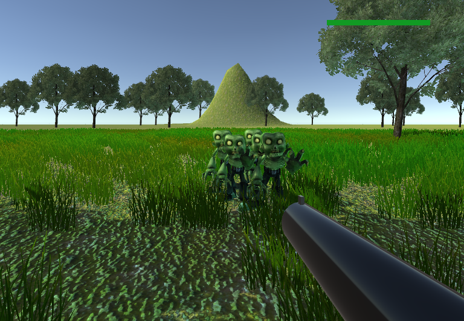
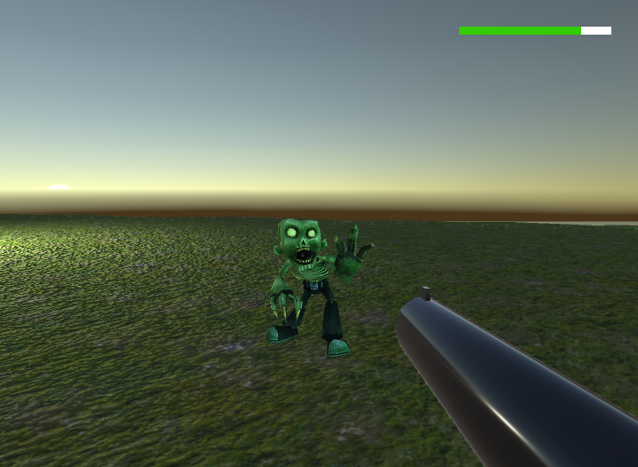
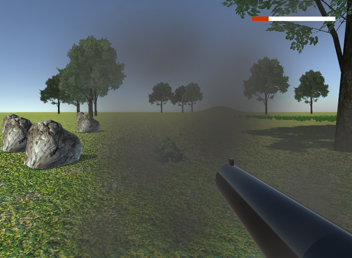
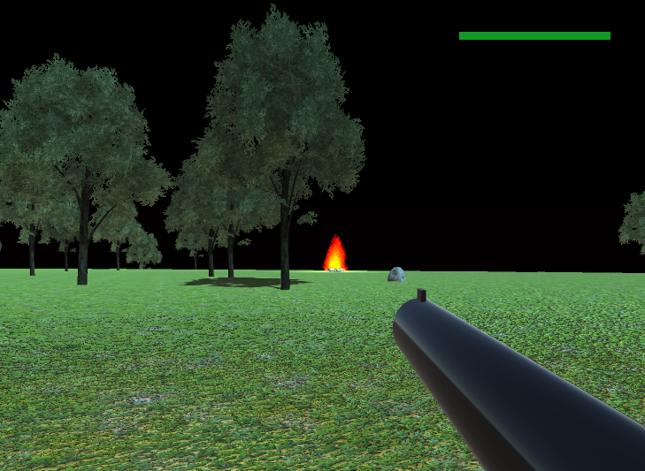
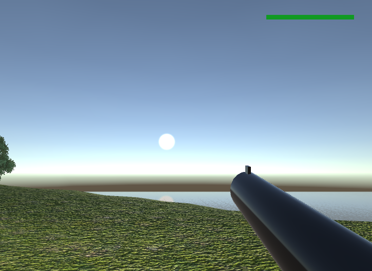
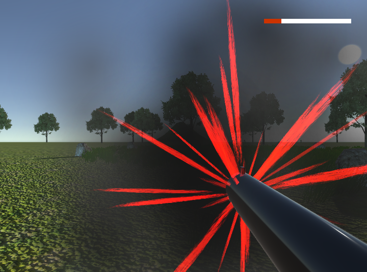
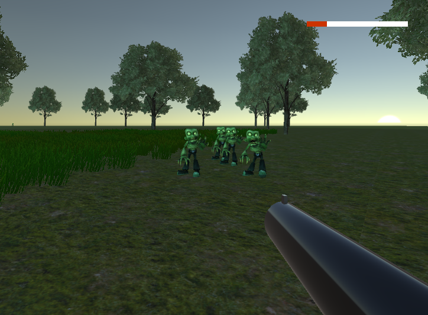

# Zombie Island

Zombilerle dolu bir adada üç gün hayatta kalmaya çalışılan, tüfekle zombi vurulan bir hayatta kalma oyunu.

## Neden?

Geniş bir açık arazide gün döngüsünü, oyuncuyu kovalayan zombileri ve ateş, kamp ateşi gibi görsel efektleri bir arada kurmak için yapıldı.

## Oynanış

- Oyuncu adada hayatta kalmaya çalışıyor, zombileri tüfekle vuruyor.
- Güneş gökyüzünde dönerek gece ve gündüz döngüsü oluşturuyor.
- Zombiler adanın rastgele noktalarında birkaç saniyede bir ortaya çıkıyor, aynı anda en fazla 20 zombi oluyor. Oyuncuyu NavMesh üzerinden takip ediyorlar.
- Üç gün dayanılırsa adadan kaçılıyor.

## Ekranlar

| Zombi | Zombi vurma |
|---|---|
|  |  |
| **Kamp ateşi** | **Gün batımı** |
|  |  |
| **Ateş** | **Zombi sürüsü** |
|  |  |

## Teknik

| | |
|---|---|
| **Motor** | Unity 2021.3.3f1 |
| **Kullanılanlar** | NavMesh Agent, görsel efektler, arazi (Terrain) |
| **Kod** | `Assets/Kodlar` (zombi, mermi, güneş, zombi üretme, takip) |
| **GitHub'a yükleme** | Mart 2023 |
